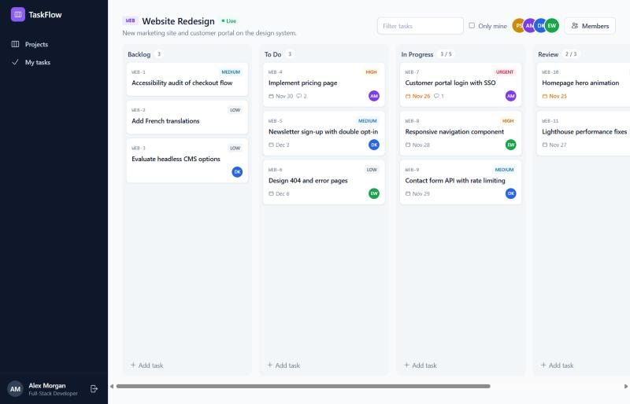
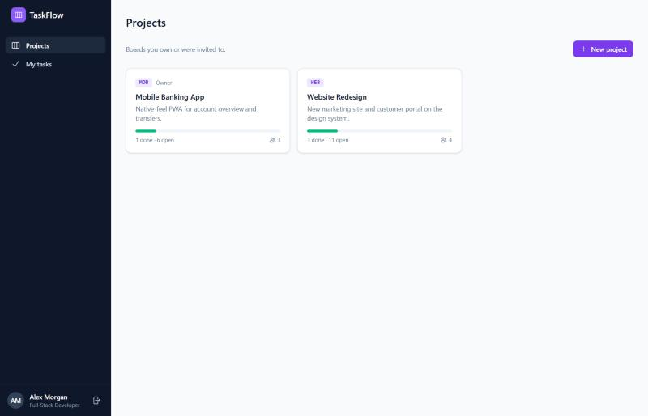
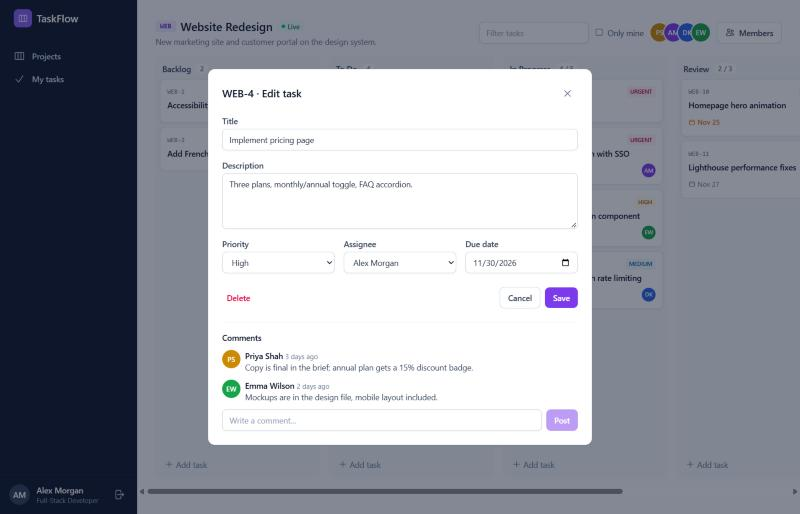
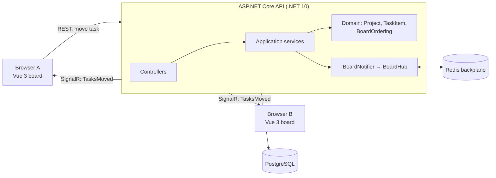

# TaskFlow — Real-time Kanban Project Management

[](https://github.com/Samgar-kz/TaskFlow/actions/workflows/ci.yml)


TaskFlow is a collaborative Kanban tool: teams share project boards, drag tasks between columns with
WIP limits, assign work, set priorities and due dates, and discuss tasks in comments. **Every change appears
instantly for everyone viewing the board**, pushed over SignalR WebSockets, with Redis as the backplane so
the API can scale to several instances.



## Features

- **Projects and members** — each project has an owner and members; the owner manages columns and membership, everyone works with tasks. Members can leave; removing someone unassigns their tasks.
- **Kanban boards** — default `Backlog → To Do → In Progress → Review → Done` layout, custom columns, and **WIP limits** that block moves into a full column.
- **Drag and drop** — native HTML5 drag and drop with drop indicators; the UI updates optimistically and reconciles with the server, rolling back if a move is refused.
- **Tasks** — sequential keys per project (`WEB-42`), priority, assignee (must be a member), due dates with overdue/soon highlighting, and comments.
- **Real-time collaboration** — task creation, edits, moves, deletions, comments and board changes are pushed to every connected teammate; the board shows a live/reconnecting indicator and resynchronises after reconnecting.
- **My tasks** — open work assigned to you across all projects, soonest due first.
- **Demo team** — four users and two populated boards, so the app is explorable right away.

| Projects | Task details and comments |
| --- | --- |
|  |  |

## Quick start

```bash
docker compose up --build
```

| What | URL |
| --- | --- |
| Web app | http://localhost:8082 |
| API reference (Scalar / OpenAPI) | http://localhost:5100/scalar |

Sign in as **demo@taskflow.dev / Demo123!**. To see real-time updates, open a private window and sign in as
**priya@taskflow.dev / Demo123!**, open *Website Redesign* in both, and move a card in one of them. The demo
accounts exist only because the local compose file enables seeding.

<details>
<summary><strong>Run without Docker</strong></summary>

Prerequisites: .NET 10 SDK, Node.js 24+, PostgreSQL 17 with a `taskflow` database owned by `taskflow` / `taskflow`. Redis is optional locally.

```bash
dotnet run --project backend/src/TaskFlow.Api      # http://localhost:5100, migrates and seeds in Development
cd frontend && npm install && npm run dev           # http://localhost:5173, proxies /api and /hubs (WebSockets)
```
</details>

## Architecture



Writes go through the REST API; after a change is committed, the application layer calls `IBoardNotifier`, which
the API implements with a strongly typed SignalR hub (`IHubContext<BoardHub, IBoardClient>`). Each open board is a
SignalR group, and a connection may join a group only after the server checks that the user is a project member.

### Design decisions

- **Ordering as pure domain logic.** `BoardOrdering` keeps positions dense (`0..n-1`) in both affected columns, enforces WIP limits and marks completion when a task enters the last column. It returns exactly the tasks whose position changed, so only those are saved and broadcast. It's fully unit-tested, and the front end mirrors it for optimistic updates.
- **Broadcast after commit.** Notifications are sent only after `SaveChanges` succeeds, so clients never see a change that was rolled back.
- **Authorisation on the hub, too.** The hub requires a JWT (sent as `access_token` for WebSockets, since browsers can't set headers there) and refuses `JoinProject` for non-members. Removed members stop getting a board as soon as it reloads.
- **Safe task numbering.** The project row carries an `xmin` concurrency token and `(project_id, number)` is unique, so two simultaneous creations can never receive the same key.
- **Scale-out ready.** With `ConnectionStrings:Redis` set, SignalR uses Redis as a backplane, so messages reach clients connected to any API instance. When running several instances behind a load balancer, enable sticky sessions (or WebSockets-only transport with negotiation skipped).
- **Owner vs. member permissions** are enforced in the domain (`NotPermittedException` → `403`); non-members get `404`, so project existence isn't leaked.

## API overview

| Method | Endpoint | Description |
| --- | --- | --- |
| `GET` `POST` | `/api/projects` | My projects; create a project (with default columns) |
| `GET` `PUT` `DELETE` | `/api/projects/{id}` | Board (columns, members, cards); rename; delete |
| `POST` `DELETE` | `/api/projects/{id}/members[/{userId}]` | Add a member by email; remove or leave |
| `POST` `PUT` `DELETE` | `/api/projects/{id}/columns[/{columnId}]` | Manage columns and WIP limits (owner) |
| `POST` | `/api/projects/{id}/tasks` | Create a task |
| `GET` `PUT` `DELETE` | `/api/tasks/{id}` | Task details with comments; edit; delete |
| `POST` | `/api/tasks/{id}/move` | Move to `{ columnId, index }`; returns changed positions |
| `POST` | `/api/tasks/{id}/comments` | Comment |
| `GET` | `/api/tasks/mine` | Open tasks assigned to me |
| `WS` | `/hubs/board` | `JoinProject` / `LeaveProject`; receives `TaskUpserted`, `TasksMoved`, `TaskDeleted`, `CommentAdded`, `BoardChanged` |

## Testing

```bash
dotnet test backend/TaskFlow.slnx
cd frontend && npm test
```

- **Domain unit tests** cover board ordering (reorders, cross-column moves, clamping, WIP limits, completion), project rules (keys, default layout, permissions, columns) and task numbering.
- **Integration tests** run the real API against PostgreSQL (Testcontainers) and include a **SignalR client connected to the test server**: a teammate receives `TaskUpserted` and `TasksMoved` pushes in real time, and the hub rejects non-members. Others cover membership, assignee rules, WIP limits, comments, "my tasks" and deletion.
- **Front-end tests** (Vitest) cover the optimistic board-state functions, due-date logic, the auth store and the HTTP client.
- **CI** runs everything, lints and type-checks the UI and builds the Docker images.

## Tech stack

| Layer | Technologies |
| --- | --- |
| Backend | C# 14, .NET 10, ASP.NET Core, SignalR (+ StackExchange.Redis backplane), EF Core 10, Npgsql, FluentValidation, JWT bearer auth with rotating refresh tokens |
| Frontend | Vue 3, TypeScript, Pinia, Vue Router, `@microsoft/signalr`, Tailwind CSS 4, Vite |
| Data | PostgreSQL 17, Redis 8 |
| Testing | xUnit, WebApplicationFactory, SignalR .NET client, Testcontainers, Vitest |
| DevOps | Docker (multi-stage, non-root), Docker Compose, Nginx with WebSocket proxying, GitHub Actions |

## Roadmap

- Presence ("Priya is viewing") and typing indicators
- Labels, sub-tasks and saved filters
- Sprint view and burndown chart
- Activity history per task

## Author

**Samgar Abdikozha** — .NET / full-stack software engineer.
[LinkedIn](https://www.linkedin.com/in/samgar-abdikozha/) · [GitHub](https://github.com/Samgar-kz)

Licensed under the [MIT License](LICENSE).
